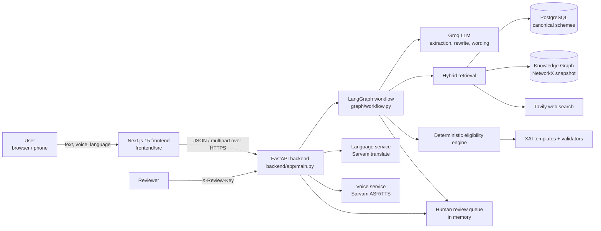
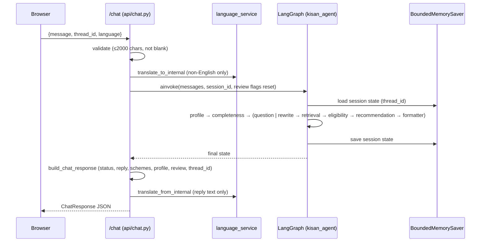
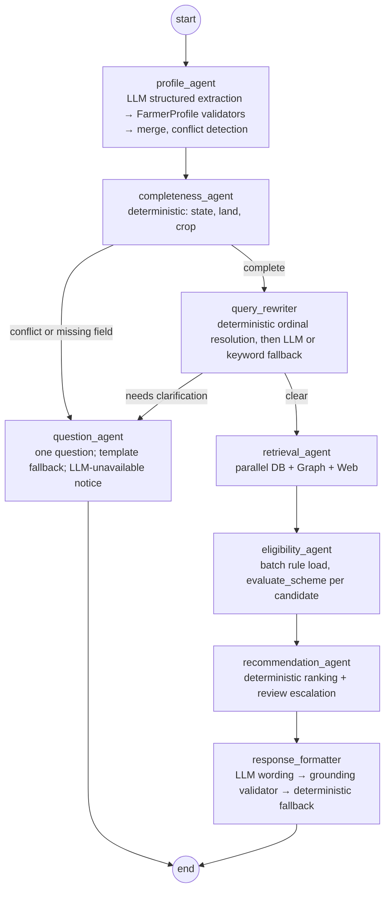
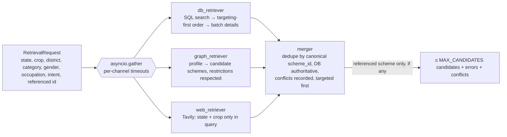
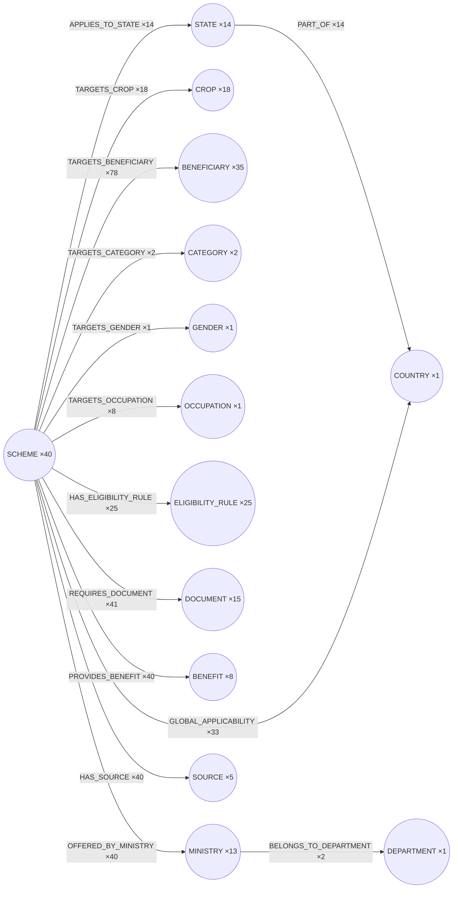
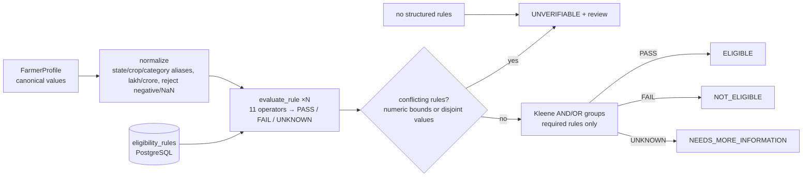
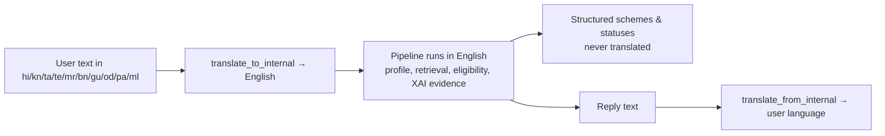
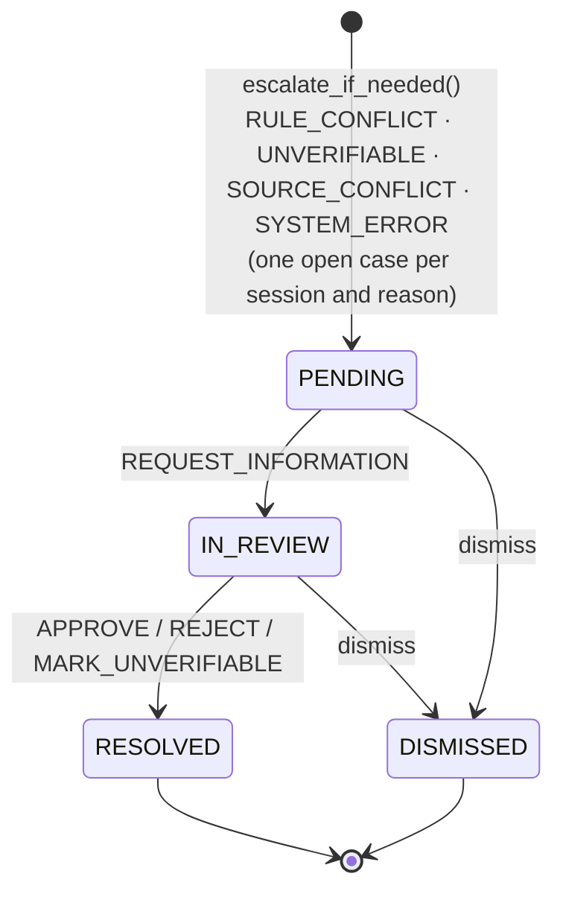
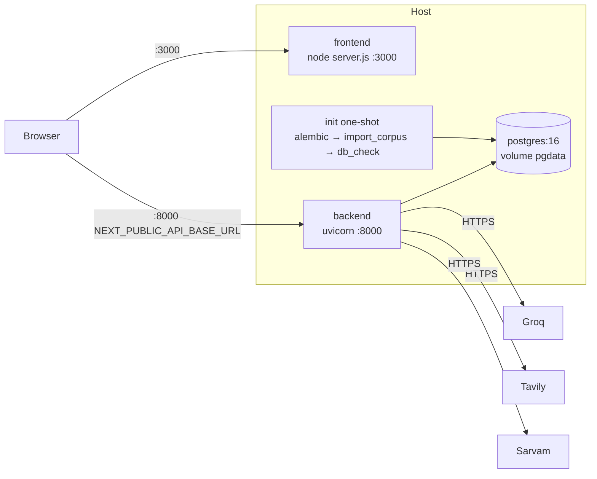

# SchemeSetu Architecture

Every diagram below matches the code at release v1.0.0. File paths are relative to the repository root.

**Responsibilities**

| Layer | Role | Code |
|---|---|---|
| PostgreSQL | Canonical system of record for scheme data (40 schemes, rules, documents, steps, sources, corpus versions) | `backend/alembic/`, `backend/app/database/` |
| Knowledge Graph (NetworkX) | *Derived* relationship and traversal layer, built from the same canonical corpus; candidate discovery only | `backend/app/knowledge_graph/` |
| LangGraph | Workflow / orchestration of the agents | `backend/app/graph/workflow.py` |
| Eligibility engine | Deterministic decision system (rules × profile → status) | `backend/app/eligibility/` |
| XAI | Evidence-based explanations and validation | `backend/app/xai/` |
| LLM (Groq, Llama 3.3 70B) | Language understanding (profile extraction), query rewriting, reply wording. **Never decides eligibility** | `backend/app/services/llm_service.py`, `agents/` |
| Tavily | External discovery; untrusted; never overwrites canonical data | `backend/app/retrieval/web_retriever.py` |
| Sarvam | ASR, TTS, translation | `backend/app/services/voice_service.py`, `language_service.py` |
| Human review | Exception path on deterministic triggers | `backend/app/services/review_service.py`, `api/review.py` |

## 1. High-level system architecture



## 2. Request lifecycle (POST /chat)



## 3. LangGraph workflow



Session state is checkpointed per `thread_id` in `BoundedMemorySaver` (`graph/workflow.py`), capped at
`MAX_SESSIONS`, with constant-cost equality and repr.

## 4. Retrieval architecture



Failures are raised by each channel and recorded in `retrieval_errors`. The other channels still answer.
Web results that cannot be mapped to a corpus scheme are dropped.

## 5. Knowledge Graph structure (corpus v1.0.0 snapshot: 179 nodes, 356 edges)



The graph is built by `scripts/build_knowledge_graph.py` from `data/validated/schemes.json` (the same file
imported into PostgreSQL) and saved to `data/graph/current/`. It is loaded once at start-up. It is **not** the
eligibility engine.

## 6. Eligibility pipeline



Derived field (documented policy): `has_land = land_size_acres > 0` when `has_land` is not stated.

## 7. Voice pipeline

```mermaid
sequenceDiagram
    participant M as Microphone (MediaRecorder, real MIME e.g. audio/webm;codecs=opus)
    participant V as /voice
    participant ASR as Sarvam ASR
    participant T as Sarvam translate
    participant G as same LangGraph pipeline
    participant TTS as /tts → Sarvam TTS
    M->>V: multipart upload + thread_id + language
    V->>V: size ≤10 MB, MIME allow-list, magic-byte sniffing, server-generated filename
    V->>ASR: audio
    ASR-->>V: transcript (or failure → error + "use text input")
    V->>T: to English (failure → untranslated text)
    V->>G: same path as /chat
    G-->>V: reply + schemes
    V->>T: reply to user language (failure → English)
    V-->>M: ChatResponse incl. user_transcript
    M->>TTS: reply text (best effort; failure → text only; user can stop audio)
```

## 8. Multilingual pipeline



11 languages are declared in `localization/languages.py`. Offline parity tests cover all 11. Live Sarvam
quality is not measured.

## 9. Human-review flow



## 10. Deployment architecture (docker-compose.yml)


