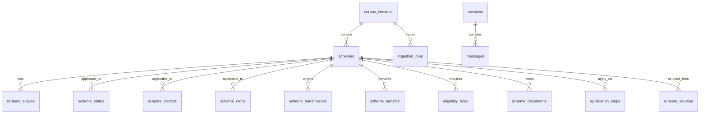

# Phase 2 — Database Schema Documentation

## Overview

Phase 2 implements a fully normalized PostgreSQL schema for the SchemeSetu canonical scheme corpus. The database serves as a **runtime query projection** of the validated Phase 1 corpus.

## Architecture

```
Validated Corpus (JSON)
        ↓
  Import Service
        ↓
  PostgreSQL (15 tables)
        ↓
  Repository Layer
        ↓
  Application
```

## ER Diagram



## Tables

### 1. corpus_versions
Tracks which canonical corpus generated the current database records.

| Column | Type | Constraints | Description |
|---|---|---|---|
| id | SERIAL | PK | Internal ID |
| version | VARCHAR(50) | NOT NULL, UNIQUE | e.g., "1.0.0" |
| schema_version | VARCHAR(50) | NOT NULL | Schema version |
| generated_at | TIMESTAMPTZ | | When corpus was generated |
| imported_at | TIMESTAMPTZ | DEFAULT NOW() | When imported to DB |
| source_count | INTEGER | | Number of sources |
| scheme_count | INTEGER | | Number of schemes |
| manifest_hash | VARCHAR(128) | | Content hash for verification |
| notes | TEXT | | Notes |

### 2. ingestion_runs
Tracks import operations for auditability.

| Column | Type | Constraints | Description |
|---|---|---|---|
| id | SERIAL | PK | |
| corpus_version_id | INTEGER | FK → corpus_versions, NOT NULL | |
| started_at | TIMESTAMPTZ | DEFAULT NOW() | |
| completed_at | TIMESTAMPTZ | | |
| status | VARCHAR(20) | CHECK: RUNNING/SUCCESS/FAILED/PARTIAL | |
| records_read | INTEGER | DEFAULT 0 | |
| records_inserted | INTEGER | DEFAULT 0 | |
| records_updated | INTEGER | DEFAULT 0 | |
| records_skipped | INTEGER | DEFAULT 0 | |
| errors | INTEGER | DEFAULT 0 | |
| warnings | INTEGER | DEFAULT 0 | |
| error_message | TEXT | | |
| source_snapshot | VARCHAR(255) | | |

### 3. schemes (core table)
Canonical scheme identity and core information.

| Column | Type | Constraints | Description |
|---|---|---|---|
| id | SERIAL | PK | Internal ID |
| scheme_id | VARCHAR(100) | UNIQUE, NOT NULL | Stable canonical ID (e.g., PM_KISAN) |
| name | VARCHAR(500) | NOT NULL | Full canonical name |
| short_name | VARCHAR(200) | | Abbreviation |
| description | TEXT | NOT NULL | |
| detailed_description | TEXT | | |
| ministry | VARCHAR(500) | | |
| department | VARCHAR(500) | | |
| level | VARCHAR(50) | CHECK: central/state/district/central_state/unknown | |
| scheme_type | VARCHAR(100) | | |
| status | VARCHAR(20) | CHECK: ACTIVE/INACTIVE/SUSPENDED/UNKNOWN | |
| eligibility_summary | TEXT | | Human-readable |
| official_url | VARCHAR(2000) | | |
| application_url | VARCHAR(2000) | | |
| application_mode | JSONB | | e.g., ["online", "bank"] |
| aadhaar_requirement | VARCHAR(30) | | |
| data_version | VARCHAR(20) | DEFAULT "1.0" | |
| last_verified_at | DATE | | |
| possible_duplicate | BOOLEAN | DEFAULT FALSE | |
| needs_review | BOOLEAN | DEFAULT FALSE | |
| review_notes | TEXT | | |
| corpus_version_id | INTEGER | FK → corpus_versions | |
| created_at | TIMESTAMPTZ | DEFAULT NOW() | |
| updated_at | TIMESTAMPTZ | DEFAULT NOW() | |

**Indexes:** scheme_id (UNIQUE), name, status, level

### 4-13. Child Tables

Each child table has `scheme_id INTEGER FK → schemes.id ON DELETE CASCADE`.

| Table | Key Columns | Unique Constraint |
|---|---|---|
| scheme_aliases | alias, normalized_alias | (scheme_id, alias) |
| scheme_states | state, is_exclusive | (scheme_id, state) |
| scheme_districts | state, district | (scheme_id, state, district) |
| scheme_crops | crop, normalized_crop | (scheme_id, crop) |
| scheme_beneficiaries | beneficiary_type | (scheme_id, beneficiary_type) |
| scheme_benefits | benefit_type, amount, description | — |
| eligibility_rules | field_name, operator, value_json, logical_group | — |
| scheme_documents | name, mandatory | (scheme_id, name) |
| application_steps | step_number, description, mode | (scheme_id, step_number) |
| scheme_sources | source_id, url, source_type, is_primary | — |

### 14-15. Session Tables (Optional)

| Table | Key Columns | Constraints |
|---|---|---|
| sessions | thread_id (UNIQUE), language, profile_json | |
| messages | session_id (FK), role (CHECK), content | |

## CHECK Constraints

- `ck_scheme_status`: ACTIVE, INACTIVE, SUSPENDED, UNKNOWN
- `ck_scheme_level`: central, state, district, central_state, unknown
- `ck_rule_operator`: EQ, NEQ, IN, NOT_IN, LT, LTE, GT, GTE, BETWEEN, CONTAINS, BOOLEAN, UNKNOWN
- `ck_logical_group`: AND, OR
- `ck_source_type`: OFFICIAL_CENTRAL, OFFICIAL_STATE, OFFICIAL_SCHEME_PORTAL, SECONDARY, UNKNOWN
- `ck_step_mode`: ONLINE, OFFLINE, CSC, OFFICE, HYBRID, UNKNOWN
- `ck_message_role`: USER, ASSISTANT, SYSTEM, TOOL
- `ck_ingestion_status`: RUNNING, SUCCESS, FAILED, PARTIAL

## Indexes

| Index | Table | Columns | Type |
|---|---|---|---|
| ix_schemes_scheme_id | schemes | scheme_id | UNIQUE |
| ix_schemes_name | schemes | name | BTREE |
| ix_schemes_status | schemes | status | BTREE |
| ix_schemes_level | schemes | level | BTREE |
| ix_scheme_aliases_normalized | scheme_aliases | normalized_alias | BTREE |
| ix_scheme_states_state | scheme_states | state | BTREE |
| ix_scheme_crops_normalized | scheme_crops | normalized_crop | BTREE |
| ix_eligibility_rules_scheme_id | eligibility_rules | scheme_id | BTREE |
| ix_eligibility_rules_field_name | eligibility_rules | field_name | BTREE |
| ix_scheme_documents_scheme_id | scheme_documents | scheme_id | BTREE |
| ix_application_steps_scheme_id | application_steps | scheme_id | BTREE |
| ix_scheme_sources_scheme_id | scheme_sources | scheme_id | BTREE |
| ix_scheme_sources_source_type | scheme_sources | source_type | BTREE |
